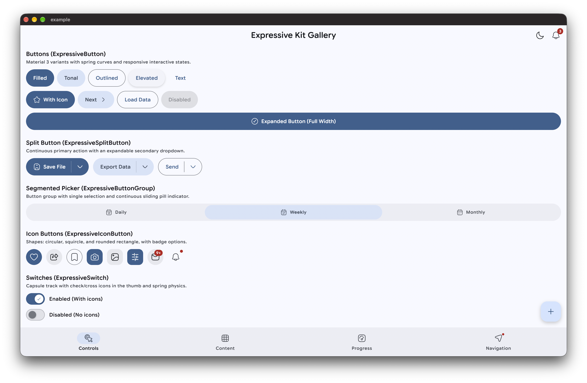
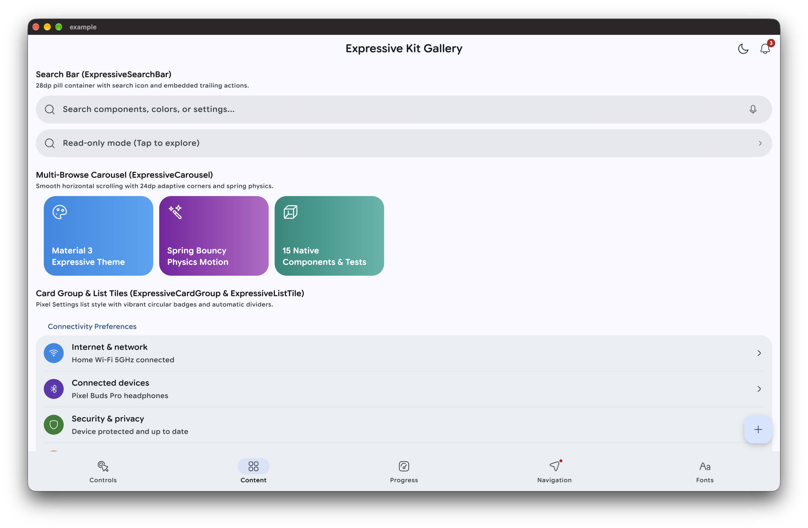
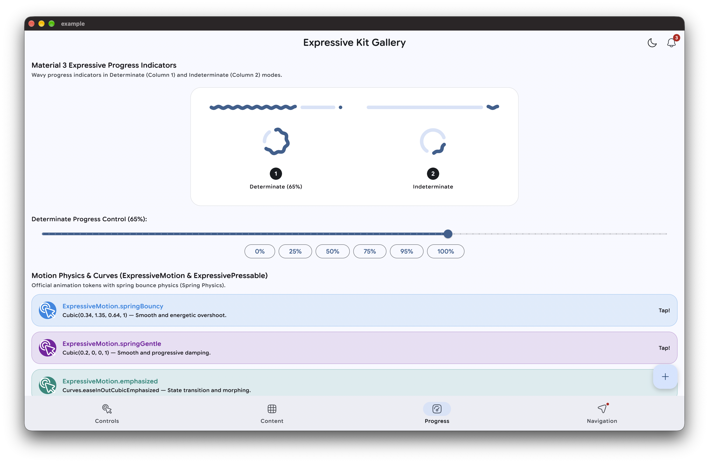
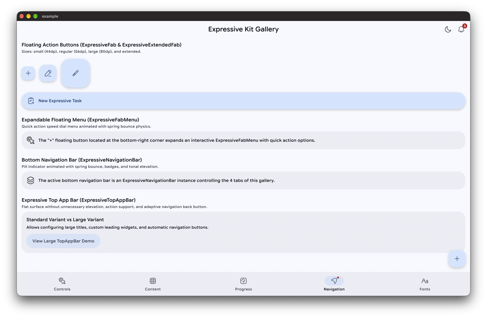
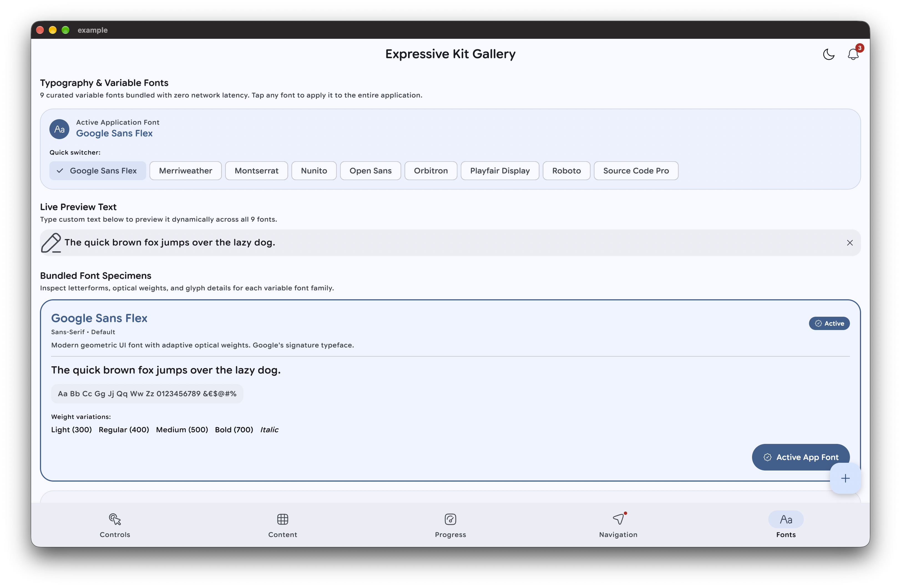

# Expressive Kit

[](https://pub.dev/packages/expressive_kit)
[](https://pub.dev/packages/expressive_kit/score)
[](https://www.codefactor.io/repository/github/Piero16301/expressive_kit)
[](https://github.com/Piero16301/expressive_kit/actions)
[](https://codecov.io/gh/Piero16301/expressive_kit)
[](https://github.com/Piero16301/expressive_kit)
[](https://opensource.org/licenses/MIT)
[](https://buymeacoffee.com/sanjuanpamk)

A modern, cohesive Flutter design system implementing **Material 3 Expressive** guidelines. `expressive_kit` brings vibrant UI components, authentic spring motion curves, tactile haptic feedback, wavy progress indicators, curated variable fonts, and full dark/light theme support into your Flutter applications.

---

## Features

- 🎨 **Material 3 Expressive Design**: Styled according to the latest M3 Expressive specifications with 24dp+ rounded corners, organic pill indicators, and vibrant tonal color mapping.
- ⚡ **Authentic Spring Motion**: Built-in motion tokens (`ExpressiveMotion.springBouncy`, `springGentle`, and `emphasized`) for natural, energetic physical feedback.
- 🌊 **Wavy Progress Indicators**: Sinusoidal linear and circular progress indicators for both determinate and indeterminate loading states with track spacing.
- 🔤 **Curated Variable Fonts**: Bundled typography presets via `ExpressiveFonts` (Google Sans Flex, Montserrat, Roboto, Open Sans, Orbitron, and more).
- 🌍 **Built-in Localization**: Out-of-the-box localizations for theme modes, colors, and languages across 6 languages (`en`, `es`, `it`, `de`, `fr`, `pt`).
- 📱 **Interactive Controls**: Buttons with loading states, split buttons with contextual dropdowns, segmented pickers, multi-shape icon buttons, switches, and sliders.
- 🛡️ **100% Test Coverage**: Production-ready, null-safe codebase tested with 100% unit and widget test coverage.
- 🤖 **AI Agent Ready**: Includes a bundled [`SKILL.md`](SKILL.md) skill guide for any AI coding assistant (Cursor, Antigravity, Claude Code, Copilot) to implement components or migrate existing codebases.

---

## Getting Started

Add `expressive_kit` and `hugeicons` to your `pubspec.yaml`:

```yaml
dependencies:
  expressive_kit: ^0.0.4
  hugeicons: ^1.2.0
```

Import it in your Dart code:

```dart
import 'package:expressive_kit/expressive_kit.dart';
import 'package:hugeicons/hugeicons.dart';
```

### Quick Theme Setup

Initialize your application with the expressive theme generator:

```dart
MaterialApp(
  title: 'My Expressive App',
  theme: ExpressiveTheme.light(
    baseColor: ExpressiveColors.defaultColor,
    fontFamily: ExpressiveFonts.defaultFont,
  ),
  darkTheme: ExpressiveTheme.dark(
    baseColor: ExpressiveColors.defaultColor,
    fontFamily: ExpressiveFonts.defaultFont,
  ),
  themeMode: ExpressiveTheme.defaultTheme,
  localizationsDelegates: ExpressiveLocalizations.localizationsDelegates,
  supportedLocales: ExpressiveLocalizations.supportedLocales,
  home: const HomeScreen(),
);
```

### 🤖 AI Agent Skill & Migration Guide

This repository includes a dedicated [`SKILL.md`](SKILL.md) designed for AI coding assistants (such as **Antigravity**, **Cursor**, **Windsurf**, **Claude Code**, or **GitHub Copilot**).

You can prompt or point your agent to [`SKILL.md`](SKILL.md) to:
- Build new screens using authentic Material 3 Expressive components.
- Configure themes, dynamic color schemes, and bundled variable fonts.
- **Migrate existing apps**: Automatically replace legacy Flutter widgets (`ElevatedButton`, `Switch`, `CircularProgressIndicator`, `AppBar`, etc.) with `expressive_kit` equivalents using the included widget replacement matrix.

---

## Component Showcase

### 1. Controls Components

Interactive input widgets and action triggers crafted with physical feedback and customizable shapes.



#### • ExpressiveButton
Versatile action buttons supporting filled, tonal, and outlined variants with built-in loading states and full-width expansion:

```dart
ExpressiveButton(
  label: 'With Icon',
  icon: const HugeIcon(icon: HugeIcons.strokeRoundedStar, size: 20),
  variant: ExpressiveButtonVariant.filled,
  onPressed: () {},
)

ExpressiveButton(
  label: 'Loading State',
  isLoading: true,
  onPressed: () {},
)
```

#### • ExpressiveSplitButton
Seamless primary action combined with an expandable secondary dropdown:

```dart
ExpressiveSplitButton(
  label: 'Save File',
  leadingIcon: const HugeIcon(icon: HugeIcons.strokeRoundedFloppyDisk, size: 20),
  variant: ExpressiveButtonVariant.filled,
  onPressed: () => print('Primary save tapped'),
  onTrailingPressed: () => print('Open secondary dropdown menu'),
)
```

#### • ExpressiveButtonGroup (Segmented Picker)
Segmented button group with a sliding pill indicator animated with spring physics:

```dart
ExpressiveButtonGroup<String>(
  selectedValue: 'Daily',
  onSelected: (value) => print('Selected: $value'),
  items: const [
    ExpressiveButtonGroupItem(
      value: 'Daily',
      label: 'Daily',
      icon: HugeIcon(icon: HugeIcons.strokeRoundedCalendar01, size: 18),
    ),
    ExpressiveButtonGroupItem(
      value: 'Weekly',
      label: 'Weekly',
      icon: HugeIcon(icon: HugeIcons.strokeRoundedCalendar02, size: 18),
    ),
    ExpressiveButtonGroupItem(
      value: 'Monthly',
      label: 'Monthly',
      icon: HugeIcon(icon: HugeIcons.strokeRoundedCalendar03, size: 18),
    ),
  ],
)
```

#### • ExpressiveIconButton
Expressive icon buttons available in three distinctive geometry styles: `circle`, `squircle`, and `roundedRectangle`, featuring optional badge text and notification dots:

```dart
ExpressiveIconButton.circle(
  icon: const HugeIcon(icon: HugeIcons.strokeRoundedFavourite),
  variant: ExpressiveIconButtonVariant.filled,
  onPressed: () {},
)

ExpressiveIconButton.squircle(
  icon: const HugeIcon(icon: HugeIcons.strokeRoundedCamera01),
  variant: ExpressiveIconButtonVariant.tonal,
  onPressed: () {},
)

ExpressiveIconButton.circle(
  icon: const HugeIcon(icon: HugeIcons.strokeRoundedMail01),
  badgeText: '9+',
  onPressed: () {},
)
```

#### • ExpressiveSwitch
Capsule-track toggle switch displaying animated check and cross icons in the sliding thumb:

```dart
ExpressiveSwitch(
  value: isEnabled,
  onChanged: (val) => setState(() => isEnabled = val),
)
```

#### • ExpressiveSlider
Continuous and discrete sliders featuring thick capsule tracks and animated spring thumb:

```dart
ExpressiveSlider(
  value: sliderValue,
  min: 0,
  max: 100,
  title: 'Sound Volume',
  subtitle: 'Media and notifications',
  onChanged: (val) => setState(() => sliderValue = val),
)
```

---

### 2. Content & Layout Components

Structured data containers, media carousels, and settings groups inspired by Google Pixel OS design.



#### • ExpressiveSearchBar
Pill-shaped 28dp radius search container with embedded leading icon, customizable trailing actions, and read-only support:

```dart
ExpressiveSearchBar(
  hintText: 'Search components, colors, or settings...',
  trailing: ExpressiveIconButton.circle(
    icon: const HugeIcon(icon: HugeIcons.strokeRoundedMic01, size: 20),
    onPressed: () {},
  ),
  onSubmitted: (query) => print('Search: $query'),
)
```

#### • ExpressiveCarousel
Smooth horizontal multi-browse carousel with 24dp adaptive corners and spring physics:

```dart
ExpressiveCarousel(
  height: 160,
  itemExtent: 220,
  items: [
    ExpressiveCarouselItem(
      onTap: () {},
      child: Container(
        decoration: BoxDecoration(
          gradient: const LinearGradient(
            colors: [Color(0xFF1E88E5), Color(0xFF42A5F5)],
          ),
          borderRadius: BorderRadius.circular(24),
        ),
        padding: const EdgeInsets.all(16),
        child: const Text('Expressive Card Item'),
      ),
    ),
  ],
)
```

#### • ExpressiveCardGroup & ExpressiveListTile
Pixel Settings-style grouped cards with vibrant circular badges, split dividers, and secondary action toggles:

```dart
ExpressiveCardGroup(
  title: 'Connectivity Preferences',
  children: [
    ExpressiveListTile(
      leading: const ExpressiveBadge(
        icon: HugeIcon(
          icon: HugeIcons.strokeRoundedWifi01,
          color: Colors.white,
          size: 20,
        ),
        backgroundColor: Color(0xFF1E88E5),
      ),
      title: const Text('Internet & network'),
      subtitle: const Text('Home Wi-Fi 5GHz connected'),
      trailing: const HugeIcon(icon: HugeIcons.strokeRoundedArrowRight01, size: 20),
      onTap: () {},
    ),
    ExpressiveListTile(
      leading: const ExpressiveBadge(
        icon: HugeIcon(
          icon: HugeIcons.strokeRoundedMoon02,
          color: Colors.white,
          size: 20,
        ),
        backgroundColor: Color(0xFFEF6C00),
      ),
      title: const Text('Dark theme'),
      subtitle: const Text('Toggle appearance'),
      showSplitDivider: true,
      secondaryTrailing: ExpressiveSwitch(
        value: isDark,
        onChanged: (val) => toggleTheme(),
      ),
    ),
  ],
)
```

#### • ExpressiveCard
Elevated standalone surface with 24dp rounded corners, smooth hover effects, and tactile touch feedback:

```dart
ExpressiveCard(
  onTap: () => print('Card pressed'),
  child: Row(
    children: [
      const ExpressiveBadge(
        icon: HugeIcon(icon: HugeIcons.strokeRoundedStar, color: Colors.black87),
        backgroundColor: Colors.amber,
      ),
      const SizedBox(width: 16),
      const Text('Expressive Experience'),
    ],
  ),
)
```

---

### 3. Progress & Motion Components

Fluid sinusoidal wave loaders and authentic spring physics curves.



#### • ExpressiveLinearProgressIndicator
Sinusoidal wavy progress indicator supporting determinate progress with end gap or continuous indeterminate waves:

```dart
// Determinate with percentage
ExpressiveLinearProgressIndicator(
  value: 0.65,
)

// Indeterminate moving wave
const ExpressiveLinearProgressIndicator()
```

#### • ExpressiveCircularProgressIndicator
Circular loader rendering geometric wave contours around its perimeter with smooth phase shifting:

```dart
// Determinate circular wave
ExpressiveCircularProgressIndicator(
  value: 0.75,
  size: 64,
)

// Indeterminate circular wave
const ExpressiveCircularProgressIndicator(
  size: 64,
)
```

#### • ExpressiveMotion
Physical tokens for spring transitions and tactile animations:

| Token | Description | Curve / Specification |
| :--- | :--- | :--- |
| `ExpressiveMotion.springBouncy` | Smooth overshoot with snappy settling | `Cubic(0.34, 1.35, 0.64, 1.0)` |
| `ExpressiveMotion.springGentle` | Gentle progressive damping without overshoot | `Cubic(0.2, 0.0, 0.0, 1.0)` |
| `ExpressiveMotion.emphasized` | Standard state transition & element morphing | `Curves.easeInOutCubicEmphasized` |

#### • ExpressivePressable
Spring tactile feedback wrapper that gracefully compresses and restores when tapped:

```dart
ExpressivePressable(
  onTap: () => print('Tactile press!'),
  child: Container(
    padding: const EdgeInsets.all(16),
    decoration: BoxDecoration(
      color: Theme.of(context).colorScheme.primaryContainer,
      borderRadius: BorderRadius.circular(16),
    ),
    child: const Text('Tap for physical spring feedback'),
  ),
)
```

---

### 4. Navigation & Floating Action Buttons

Navigation bars, adaptive top app bars, and animated expandable speed dials.



#### • ExpressiveFab & ExpressiveExtendedFab
Floating action buttons available in three standard Material 3 Expressive sizes plus an extended variant:

```dart
// Small (44dp)
ExpressiveFab(
  icon: const HugeIcon(icon: HugeIcons.strokeRoundedAdd01),
  size: ExpressiveFabSize.small,
  onPressed: () {},
)

// Regular (56dp)
ExpressiveFab(
  icon: const HugeIcon(icon: HugeIcons.strokeRoundedEdit02),
  size: ExpressiveFabSize.regular,
  onPressed: () {},
)

// Large (80dp)
ExpressiveFab(
  icon: const HugeIcon(icon: HugeIcons.strokeRoundedPaintBrush01),
  size: ExpressiveFabSize.large,
  onPressed: () {},
)

// Extended with label
ExpressiveExtendedFab(
  icon: const HugeIcon(icon: HugeIcons.strokeRoundedTaskAdd01),
  label: 'New Task',
  onPressed: () {},
)
```

#### • ExpressiveFabMenu
Expandable speed dial floating menu with spring physics expansion and backdrop blur:

```dart
ExpressiveFabMenu(
  items: [
    ExpressiveFabMenuItem(
      icon: const HugeIcon(icon: HugeIcons.strokeRoundedShare01),
      label: 'Share',
      onTap: () => print('Share tapped'),
    ),
    ExpressiveFabMenuItem(
      icon: const HugeIcon(icon: HugeIcons.strokeRoundedBookmark02),
      label: 'Save',
      onTap: () => print('Save tapped'),
    ),
    ExpressiveFabMenuItem(
      icon: const HugeIcon(icon: HugeIcons.strokeRoundedAdd01),
      label: 'New item',
      onTap: () => print('New item tapped'),
    ),
  ],
)
```

#### • ExpressiveNavigationBar
Bottom navigation bar featuring smooth pill indicator transitions, animated icons, and notification dots:

```dart
ExpressiveNavigationBar(
  selectedIndex: currentIndex,
  onDestinationSelected: (index) => setState(() => currentIndex = index),
  destinations: const [
    ExpressiveNavigationDestination(
      icon: HugeIcon(icon: HugeIcons.strokeRoundedCursorPointer01),
      label: 'Controls',
    ),
    ExpressiveNavigationDestination(
      icon: HugeIcon(icon: HugeIcons.strokeRoundedGridTable),
      selectedIcon: HugeIcon(icon: HugeIcons.strokeRoundedDashboardSquare01),
      label: 'Content',
    ),
    ExpressiveNavigationDestination(
      icon: HugeIcon(icon: HugeIcons.strokeRoundedDashboardSpeed01),
      label: 'Progress',
    ),
    ExpressiveNavigationDestination(
      icon: HugeIcon(icon: HugeIcons.strokeRoundedNavigation03),
      label: 'Navigation',
      showBadgeDot: true,
    ),
  ],
)
```

#### • ExpressiveTopAppBar
Modern top bar supporting standard and large title display, action slots, and automatic adaptive pop buttons:

```dart
// Standard app bar
ExpressiveTopAppBar(
  title: const Text('Page Title'),
  actions: [
    ExpressiveIconButton.circle(
      icon: const HugeIcon(icon: HugeIcons.strokeRoundedNotification01),
      onPressed: () {},
    ),
  ],
)

// Large title app bar
ExpressiveTopAppBar.large(
  titleText: 'Large Heading',
  actions: [
    ExpressiveIconButton.circle(
      icon: const HugeIcon(icon: HugeIcons.strokeRoundedInformationCircle),
      onPressed: () {},
    ),
  ],
)
```

### 5. Typography & Variable Fonts

Curated variable fonts bundled locally with zero network requests, optical weight variations, and live global theme switching.



#### • ExpressiveFonts
Easily apply bundled variable fonts to your themes or individual text styles:

```dart
// Apply to global theme
MaterialApp(
  theme: ExpressiveTheme.light(
    baseColor: const Color(0xFF1E88E5),
    fontFamily: ExpressiveFonts.googleSansFlex,
  ),
  home: const HomeScreen(),
);

// Apply to individual TextStyles
Text(
  'Expressive Heading',
  style: TextStyle(
    fontFamily: ExpressiveFonts.orbitron,
    fontWeight: FontWeight.bold,
  ),
);

// Inspect all available font families
final fontsMap = ExpressiveFonts.availableFonts;
```

| Family Constant | Typeface Name | Style Category |
| :--- | :--- | :--- |
| `ExpressiveFonts.googleSansFlex` | Google Sans Flex | Sans-Serif • Clean UI / Modern (Default) |
| `ExpressiveFonts.merriweather` | Merriweather | Serif • Editorial Reading |
| `ExpressiveFonts.montserrat` | Montserrat | Geometric Sans • Punchy Branding |
| `ExpressiveFonts.nunito` | Nunito | Rounded Sans • Friendly & Approachable |
| `ExpressiveFonts.openSans` | Open Sans | Humanist Sans • Neutral Mobile |
| `ExpressiveFonts.orbitron` | Orbitron | Display • Futuristic / Sci-Fi / Numbers |
| `ExpressiveFonts.playfairDisplay` | Playfair Display | High-Contrast Serif • Classical Elegance |
| `ExpressiveFonts.roboto` | Roboto | Neo-Grotesque Sans • Natural Reading |
| `ExpressiveFonts.sourceCodePro` | Source Code Pro | Monospace • Code & Terminals |

---

### 6. Colors & Localization

#### • ExpressiveColors
Standardized 19-color dynamic palette with key-based resolution and default color:

```dart
// Predefined default color
final defaultColor = ExpressiveColors.defaultColor; // Colors.teal

// Lookup color by key
final redColor = ExpressiveColors.fromKey('RED');
final colorKey = ExpressiveColors.toKey(Colors.teal); // 'TEAL'

// Access the complete palette
final allColors = ExpressiveColors.palette;
```

#### • Built-in Localization (`ExpressiveLocalizations`)
Provides localized labels for themes, colors, and languages across 6 locales: English (`en`), Spanish (`es`), Italian (`it`), German (`de`), French (`fr`), and Portuguese (`pt`).

```dart
// Convenient extension methods
final themeName = ThemeMode.system.localizedName(context);       // e.g. "Sistema" / "System"
final languageName = const Locale('it').localizedName(context);  // e.g. "Italiano" / "Italian"
final colorName = Colors.teal.localizedName(context);            // e.g. "Turquesa" / "Teal"
```

---

## Contributing

Contributions, issues, and feature requests are welcome! Feel free to check the [issues page](https://github.com/Piero16301/expressive_kit/issues).

## License

This project is licensed under the MIT License - see the [LICENSE](LICENSE) file for details.
